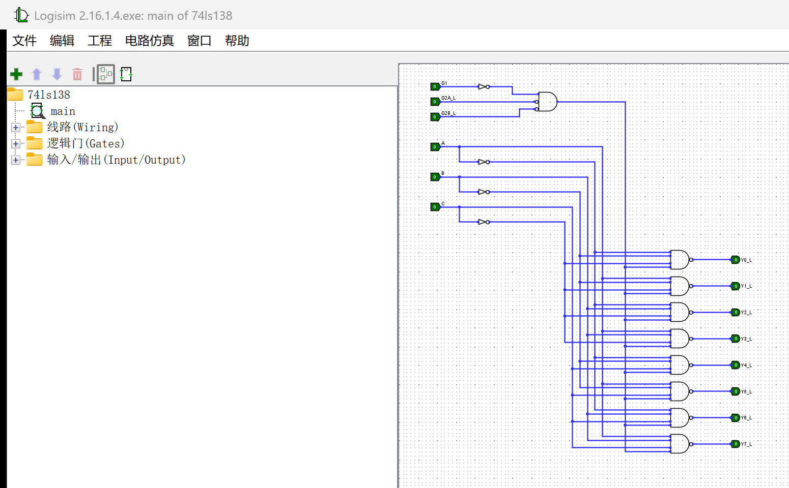

# logisim-forge

> 用代码画 Logisim 电路，并让 Logisim 自己验证它对不对。



Logisim 没有插件 API、没有 socket、没有命令行控制接口。它唯一稳定的对外接口是
**`.circ` 文件**——一个纯文本 XML。这个项目就把这条缝隙做成工具：

- **写**：用 Python 描述电路（门、引脚、总线），生成 Logisim 能直接打开的 `.circ`；
- **验**：调用 **Logisim 自己的加载器**把文件读回来，重建网络表，检查悬空线头、短路、多驱动；
- **用**：包成 MCP server，任何支持 MCP 的客户端都能"说一句话画一个电路"。

## 为什么不是"直接点鼠标"

手工拖 8 个与非门 + 24 根地址线，改一次布局就要重拖一遍。代码生成的好处是**可复现、可 diff、可批量**：
74LS138 这种"一行公式展开成 27 个元件"的电路，用循环写只要 40 行，而且改地址位顺序只改一个数组。

难的是**坐标**：Logisim 按 10px 网格布局，门元件的 `loc` 是**输出端口**而不是左上角，
输入端口在左侧、偏移量随输入个数变化，加反相圈还会把端口再往左挪 10px。差一格线就连不上，
而 Logisim **不会报错**——它只是静静地画一根没接上的线。项目里把这些几何规则做成了表
（`logisim_forge/geometry.py`），并且用"读回校验"兜底。

## 安装

```bash
git clone https://github.com/one-number-three/logisim-forge
cd logisim-forge
pip install -e .            # 只需要 Python 3.9+
pip install -e ".[mcp]"     # 想跑 MCP server 再装这个
```

校验功能需要 Java + 一个 Logisim 的 jar（Logisim 2.7.1 或 Logisim-ITA / Logisim-evolution 均可）：

```bash
set LOGISIM_JAR=E:\Logisim\Logisim-ITA.exe          # Windows
export LOGISIM_JAR=/usr/share/logisim/logisim.jar   # Linux
export JAVA_HOME=/path/to/jdk                        # 或者确保 java 在 PATH 里
```

## 快速开始

```bash
python examples/74ls138.py     # 生成 examples/74ls138.circ 并自检
python -m logisim_forge verify examples/74ls138.circ
```

```json
{
  "components": 27,
  "wires": 96,
  "nets": 19,
  "dangling": [],
  "conflicts": {},
  "ok": true
}
```

`dangling` 就是"看起来断掉的线头"，`conflicts` 是两个驱动接到同一根线上的短路。
两个都为空才算过。

### 作为库用

```python
from logisim_forge import Circuit, verify

c = Circuit("main")
c.pin((110, 100), "A")            # 输入引脚（驱动电路）
c.not_gate((240, 100))            # 输出端口在 (240,100)，输入在 (210,100)
c.pin((320, 100), "Y", direction="out")

c.wire((110, 100), (210, 100))    # A -> 非门输入
c.wire((240, 100), (320, 100))    # 非门输出 -> Y
c.save("not.circ")

print(verify("not.circ", drivers=c.drivers()).as_dict())
```

### 作为 MCP server 用

```json
{
  "mcpServers": {
    "logisim": {
      "command": "python",
      "args": ["-m", "logisim_forge", "serve"],
      "env": { "LOGISIM_JAR": "E:/Logisim/Logisim-ITA.exe" }
    }
  }
}
```

| 工具 | 作用 |
| --- | --- |
| `create_circuit(name)` | 新建空电路 |
| `add_pin(x, y, label, direction)` | 加引脚，返回端口坐标 |
| `add_gate(kind, x, y, inputs, negated)` | 加门，`(x,y)` 是**输出**端口，返回全部端口 |
| `add_led(x, y)` | 加 LED |
| `add_wire(points)` | 折线布线（只能横平竖直） |
| `list_components()` | 列出元件和端口，方便改线 |
| `save_circuit(path)` | 写 `.circ` |
| `verify_circuit(path)` | 让 Logisim 读回并检查断头/短路 |

设计上有一个刻意的取舍：**所有 add_* 都返回端口坐标**。模型不需要背几何表，
拿到 `ports` 直接连线就不会差一格——这是把"人类经验"塞进工具返回值里。

## 示例：74LS138 3-8 译码器


| 部分 | 实现 |
| --- | --- |
| 使能 | 3 输入与门，输入为 `~G1`、`G2A_L`、`G2B_L`（后两个画反相圈） |
| 地址 | `A/B/C` 各一个非门，六根线做成竖直总线 |
| 译码 | 8 个 4 输入与非门，每门接三个地址位（原/反）+ 使能项 |
| 输出 | `Y0_L ~ Y7_L`，低有效 |

原理、真值表和级联扩展见 [docs/3-to-8-decoder.md](docs/3-to-8-decoder.md)。

## 原理

```
           ┌──────────────┐
Circuit ──▶│ to_xml()     │──▶ .circ ──▶ Logisim 打开
           └──────────────┘                    │
                   ▲                           │  Loader
                   │                           ▼
            几何表 / 切分                 LoadDump（Java）
                   │                           │
                   └──── 网络表 ◀──────────────┘
                          │
                dangling / conflicts
```

1. `Circuit` 只存元件和折线，不存"连接关系"；
2. 保存前在**每个端口和拐点处把线切开**，这样所有连接都是端点对端点，不依赖 Logisim 的 junction 自动修复；
3. `LoadDump` 用 Logisim 的 `Loader` 读回文件，打印元件、端口方向、导线；
4. Python 侧做并查集，检查悬空端点和多驱动网络。

## 已知的坑

这些是踩出来的，不是查文档查到的，全部整理在 [docs/pitfalls.md](docs/pitfalls.md)：
引脚 `tristate` 默认 true、总线没收在最后一个分支、反相圈让端口左移 10px、
斜线让 Logisim 加载时死循环、`lib` 索引不能省、门的 `size` 只接受 30/50……

## 路线图

- [x] `.circ` 生成 + 读回校验
- [x] MCP 工具集
- [x] 74LS138 示例
- [ ] 自动布局（网表 → 坐标）
- [ ] 真值表仿真校验（驱动引脚 + 读输出）
- [ ] 时序电路（触发器 / 时钟）支持

## 许可

MIT
